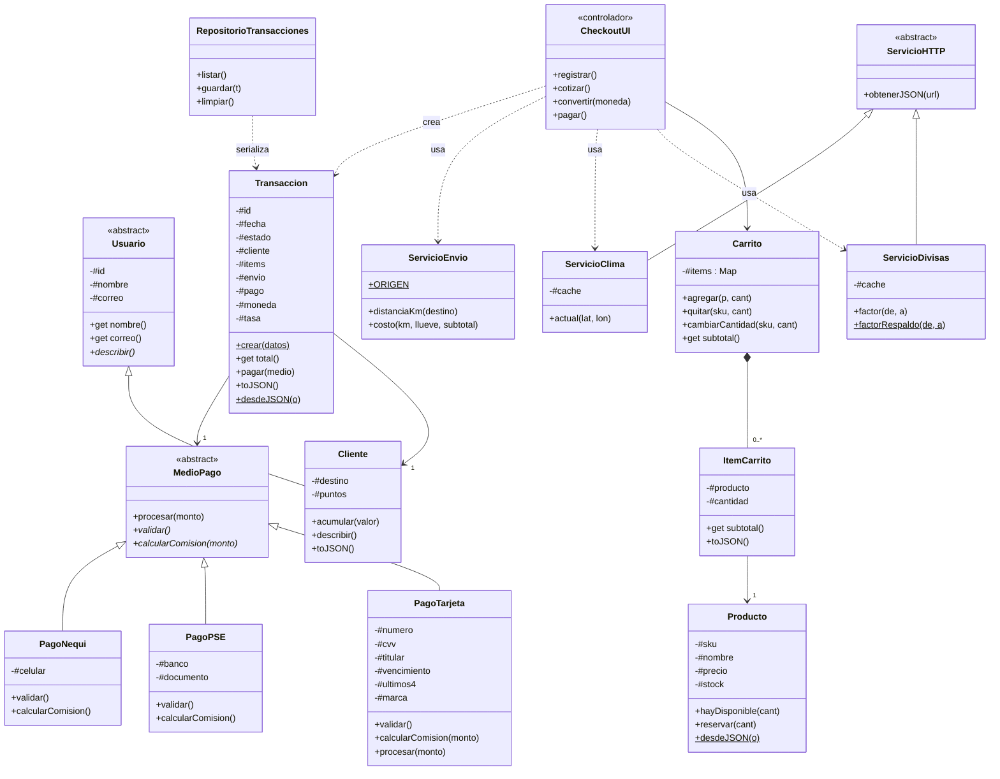

# 🥥 Coquito Amarillo SAS · Tienda web transaccional (prototipo)

Proyecto integrador de la **Unidad 3 – Programación Orientada a Objetos en JavaScript (ES6+)**,
curso *Lenguajes de Programación para la Web* (LPW01), Fundación Universitaria María Cano, 2026-2.

🔗 **Sitio publicado:** https://USUARIO.github.io/coquito-amarillo-webapp/
📁 **Repositorio:** https://github.com/USUARIO/coquito-amarillo-webapp

---

## 1. Descripción

Coquito Amarillo SAS (empresa ficticia) vende productos típicos colombianos desde su bodega en Medellín
y hoy recibe pedidos por WhatsApp. Este prototipo de una sola página permite al cliente registrarse,
armar su carrito, cotizar el envío, ver el total en otra moneda, pagar y consultar su historial.

| RF | Funcionalidad |
|----|---------------|
| RF-01 | Registro del cliente (nombre, correo, ciudad o ubicación GPS) con validaciones dentro de `Usuario`/`Cliente` y autorización de datos (Ley 1581 de 2012). |
| RF-02 | Catálogo creado con `Producto.desdeJSON()` a partir de `data/productos.json`. |
| RF-03 | Agregar, quitar y cambiar cantidades en el carrito sin superar el stock. |
| RF-04 | Cotización del envío según la distancia a la bodega (haversine) y el clima del destino (**API 2: Open-Meteo**). |
| RF-05 | Totales en COP y conversión a USD o EUR (**API 1: ExchangeRate-API**). |
| RF-06 | Pago con Tarjeta, PSE o Nequi; cada medio valida sus propios datos (polimorfismo). |
| RF-07 | `Transaccion` con id único, fecha, tasa usada y estado, y recibo en pantalla. |
| RF-08 | Historial en `localStorage` (`toJSON()` + `Transaccion.desdeJSON()`). |

**Tecnologías:** HTML5, CSS3 y JavaScript ES2022 con módulos ES (`import`/`export`), sin frameworks ni librerías.

---

## 2. Diagrama de clases (UML)


Versión Mermaid (GitHub la dibuja automáticamente):



### Pilares de la POO en el código

| Pilar | Dónde se ve |
|-------|-------------|
| **Encapsulamiento** | Campos `#` en todas las clases; `Producto.precio` tiene un setter que valida; `Transaccion` no tiene setters; el número y el CVV de la tarjeta son privados y se borran después de pagar. |
| **Herencia** | `Cliente extends Usuario`; `PagoTarjeta`, `PagoPSE` y `PagoNequi extends MedioPago`; `ServicioDivisas` y `ServicioClima extends ServicioHTTP`. |
| **Polimorfismo** | `transaccion.pagar(medio)` funciona con cualquier `MedioPago`; cada uno sobrescribe `validar()` y `calcularComision()`. |
| **Abstracción** | `Usuario`, `MedioPago` y `ServicioHTTP` no se pueden instanciar (`new.target`); sus métodos abstractos lanzan error si no se implementan. |

### Cambios frente al diagrama propuesto (justificación)

1. **`RepositorioTransacciones`** (nueva): saca el acceso a `localStorage` del modelo y de la interfaz. Si se cambia el almacenamiento, solo se modifica esta clase.
2. **`ServicioHTTP`** (nueva, abstracta): `ServicioDivisas` y `ServicioClima` heredan `obtenerJSON()` con tiempo límite y verificación HTTP, en vez de repetir ese código.
3. **`Transaccion.crear()` y `Transaccion.desdeJSON()`**: el constructor está protegido; solo se crean transacciones nuevas válidas o se reconstruyen las guardadas.

---

## 3. Decisiones de diseño del equipo

1. **La tasa de cambio se guarda en la `Transaccion`** al crearla, así el recibo siempre muestra lo que se cobró aunque la tasa cambie después.
2. **Los datos de tarjeta solo viven en memoria**: `PagoTarjeta` guarda el número y el CVV en campos `#`, los borra después de `procesar()`, y en el recibo y el historial solo queda la franquicia con los últimos 4 dígitos (por ejemplo `Visa •••• 1111`).
3. **Las URL de las APIs solo están en las clases de servicio**, y la interfaz aplica degradación elegante: si una API falla, se usa un valor de respaldo, se avisa al usuario y la compra continúa.
4. **Las reglas de validación están en las clases y el formato en la interfaz**: `PagoTarjeta` decide si un número, fecha o CVV es válido; `CheckoutUI` solo da formato a lo que el usuario escribe. Así cada regla está en un solo lugar.

---

## 4. Medios de pago

### 4.1 Selección del medio

- Al cargar la página **ningún medio está seleccionado** y solo se ven las opciones: Tarjeta, PSE y Nequi.
- Al elegir un medio aparece **únicamente** su formulario; los otros dos quedan ocultos.
- Si se pulsa **Pagar** sin elegir medio, aparece el mensaje *"Seleccione un medio de pago."*
- Después de un pago aprobado se limpian los datos, se desmarca la opción y se ocultan los formularios.

> Nota técnica: se agregó la regla CSS `[hidden] { display: none !important; }` porque la clase `.rejilla-2` (`display: grid`) anulaba el atributo `hidden` y dejaba visibles los formularios de Tarjeta y PSE.

### 4.2 Comisiones (ilustrativas)

| Medio | Comisión | Datos que valida |
|-------|----------|------------------|
| Tarjeta | 2,9 % del valor | Número, titular, vencimiento y CVV |
| PSE | $1.500 fija | Banco, tipo de persona y documento (6 a 10 dígitos) |
| Nequi | Sin costo | Celular de 10 dígitos que empieza por 3 |

### 4.3 Validación de tarjetas (en `PagoTarjeta`)

| Campo | Regla | Mensaje de error |
|-------|-------|------------------|
| Número | Solo dígitos, **15 o 16 dígitos** | *El número de tarjeta debe tener 15 o 16 dígitos.* |
| Número | Debe pasar el **algoritmo de Luhn** | *Número de tarjeta inválido.* |
| Titular | Mínimo 3 caracteres | *Escriba el nombre del titular como aparece en la tarjeta.* |
| Vencimiento | Formato **MM/AA**, mes entre 01 y 12 | *La fecha de vencimiento debe tener el formato MM/AA (ej: 12/28).* |
| Vencimiento | No puede ser anterior al mes actual | *La tarjeta está vencida.* |
| CVV | Solo dígitos, **3 o 4** | *El CVV debe tener entre 3 y 4 dígitos.* |

**¿Qué es el algoritmo de Luhn?** Es una comprobación matemática que cumplen las tarjetas reales. De derecha a izquierda se duplica un dígito sí y uno no (si el doble pasa de 9 se le resta 9) y se suman todos. El número es válido solo si la suma es múltiplo de 10. Sirve para detectar números mal digitados aunque tengan la longitud correcta.

### 4.4 Formato automático (en `CheckoutUI`)

| Campo | El usuario escribe | Se muestra |
|-------|--------------------|------------|
| Número de 16 dígitos (grupos 4-4-4-4) | `4111111111111111` | `4111 1111 1111 1111` |
| Número Amex de 15 dígitos (grupos 4-6-5) | `378282246310005` | `3782 822463 10005` |
| Vencimiento | `1129` | `11/29` |
| CVV | `123` | `•••` |

- Los campos solo aceptan números: las letras y los símbolos se eliminan al escribir o pegar.
- La barra del vencimiento se agrega sola y se puede borrar con Retroceso.
- La franquicia se detecta por los primeros dígitos: **Visa** (empieza por 4), **Mastercard** (51–55 o 22–27) y **Amex** (34 o 37). Otras se muestran como "Tarjeta".

---

## 5. Datos de prueba

> ⚠️ Son **números de prueba públicos** que cumplen las reglas (longitud y Luhn). **No corresponden a tarjetas reales** y los pagos de esta app son **simulados**. Nunca uses datos de una tarjeta real.

### 5.1 Tarjetas válidas

Úsalas con cualquier titular (ej. `Juan Pablo Ramirez`) y un vencimiento futuro (ej. `1228` → `12/28`, o `0630` → `06/30`).

| Franquicia | Número (escribir sin espacios) | Se muestra | CVV | En el recibo |
|------------|-------------------------------|------------|-----|--------------|
| Visa | `4111111111111111` | `4111 1111 1111 1111` | `123` | Visa •••• 1111 |
| Visa | `4242424242424242` | `4242 4242 4242 4242` | `123` | Visa •••• 4242 |
| Visa | `4012888888881881` | `4012 8888 8888 1881` | `456` | Visa •••• 1881 |
| Visa (débito) | `4000056655665556` | `4000 0566 5566 5556` | `789` | Visa •••• 5556 |
| Mastercard | `5555555555554444` | `5555 5555 5555 4444` | `123` | Mastercard •••• 4444 |
| Mastercard | `5105105105105100` | `5105 1051 0510 5100` | `321` | Mastercard •••• 5100 |
| Mastercard (serie 2) | `2223003122003222` | `2223 0031 2200 3222` | `654` | Mastercard •••• 3222 |
| Mastercard (débito) | `5200828282828210` | `5200 8282 8282 8210` | `987` | Mastercard •••• 8210 |
| American Express | `378282246310005` | `3782 822463 10005` | `1234` | Amex •••• 0005 |
| American Express | `371449635398431` | `3714 496353 98431` | `4321` | Amex •••• 8431 |
| American Express | `340000000000009` | `3400 000000 00009` | `1111` | Amex •••• 0009 |

### 5.2 Casos que deben fallar

| Prueba | Datos | Resultado esperado |
|--------|-------|--------------------|
| Longitud incorrecta | `41111111111111` (14 dígitos) | *El número de tarjeta debe tener 15 o 16 dígitos.* |
| No pasa Luhn | `4111111111111112` | *Número de tarjeta inválido.* |
| No pasa Luhn | `1000022242231222` | *Número de tarjeta inválido.* |
| Mes inválido | Vencimiento `1329` → `13/29` | *La fecha de vencimiento debe tener el formato MM/AA (ej: 12/28).* |
| Tarjeta vencida | Vencimiento `0124` → `01/24` | *La tarjeta está vencida.* |
| CVV corto | `12` | *El CVV debe tener entre 3 y 4 dígitos.* |
| Letras | Escribir `abc` en número, vencimiento o CVV | Las letras no aparecen en el campo |
| Sin medio de pago | Pulsar **Pagar** sin elegir medio | *Seleccione un medio de pago.* |

### 5.3 PSE y Nequi

| Medio | Datos válidos | Dato inválido de prueba |
|-------|---------------|-------------------------|
| PSE | Banco: Bancolombia · Persona: Natural · Documento: `1036123456` | Documento `123` → error |
| Nequi | Celular: `3001234567` | `2001234567` → error |

### 5.4 Flujo completo sugerido

1. Registrar el cliente: `Juan Pablo Ramirez`, `jp@correo.co`, ciudad **Bogotá**, marcar la autorización.
2. Agregar productos (intentar agregar 6 *Coquitos x12* para ver el control de stock: solo hay 5).
3. **Cotizar envío** → distancia ≈ 239 km y clima de Open-Meteo.
4. Cambiar la moneda a **USD** o **EUR**.
5. Elegir **Tarjeta**, escribir `4111111111111111`, `1228`, `123` y pagar.
6. Revisar el recibo (estado **APROBADA**, `Visa •••• 1111`).
7. Recargar la página (F5): la compra sigue en el **Historial**.
8. En DevTools › Application › Local Storage, comprobar que **no aparece** el número completo ni el CVV.

### 5.5 Prueba de APIs caídas

En DevTools › Network, marcar **Disable cache**, clic derecho sobre las peticiones a `open.er-api.com` y `api.open-meteo.com` → **Block request domain**, y recargar. La app muestra un aviso, usa valores de respaldo y la compra continúa. (No usar el modo *Offline*: también bloquea la página.)

---

## 6. APIs usadas y atribución

| API | Endpoint | Uso | Clave |
|-----|----------|-----|-------|
| API 1 · ExchangeRate-API (open access) | `https://open.er-api.com/v6/latest/USD` | Conversión COP ↔ USD/EUR | No requiere; exige atribución |
| API 2 · Open-Meteo | `https://api.open-meteo.com/v1/forecast` | Clima actual del destino (recargo por lluvia) | No requiere (uso no comercial) |
| Geolocation API del navegador | `navigator.geolocation` | Coordenadas del cliente | Permiso del usuario; HTTPS |

> Tasas de cambio provistas por [ExchangeRate-API](https://www.exchangerate-api.com). Datos meteorológicos de [Open-Meteo.com](https://open-meteo.com/) (CC BY 4.0).
> Tarifas de envío ($8.000 + $35/km, +$3.000 si llueve, gratis desde $250.000), comisiones y tasas de respaldo son **ilustrativas**. Los pagos son **simulados**.

---

## 7. Privacidad (Ley 1581 de 2012)

- El cliente debe **autorizar el tratamiento de datos** antes de registrarse; el aviso de privacidad está en el formulario.
- Nombre, correo y ubicación se usan solo para gestionar el pedido y calcular el envío.
- El número de tarjeta y el CVV **nunca se guardan ni se envían**: se validan en el navegador y se borran de memoria al terminar el pago.

---

## 8. Estructura

```
coquito-amarillo-webapp/
├── index.html
├── css/estilos.css
├── data/productos.json
├── docs/diagrama-clases.png
├── js/
│   ├── main.js
│   ├── modelo/     Usuario · Cliente · Producto · ItemCarrito · Carrito · Transaccion
│   ├── pagos/      MedioPago · PagoTarjeta · PagoPSE · PagoNequi
│   ├── servicios/  ServicioHTTP · ServicioDivisas · ServicioClima · ServicioEnvio · RepositorioTransacciones
│   └── ui/         CheckoutUI
└── README.md
```

---

## 9. Cómo ejecutarlo

Los módulos ES **no cargan con doble clic** (`file://`). Opciones:

- VS Code → clic derecho en `index.html` → **Open with Live Server**.
- Terminal: `npx serve` dentro de la carpeta.
- Abrir la URL de GitHub Pages (ahí también funciona el botón **Usar mi ubicación**, porque usa HTTPS).

---

## 10. Equipo y créditos

| Integrante | Rol | Usuario GitHub |
|------------|-----|----------------|
| Juan Pablo Ramírez Zapata | Modelo (clases de dominio) | @USUARIO |
| INTEGRANTE 2 | Servicios y APIs | @usuario2 |
| INTEGRANTE 3 | Interfaz (HTML/CSS/CheckoutUI) | @usuario3 |

Docente: Luis Fernando Sánchez Pérez · Coquito Amarillo SAS es una empresa ficticia con fines académicos.

## Licencia

Proyecto académico bajo licencia MIT.